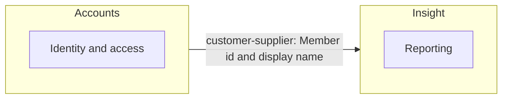

# Context map

Generated from `context-map.json`; edit the map through `plan-stories`, not this file.

## Contexts

| Context | Owner | Epics | Purpose |
|---|---|---|---|
| Accounts | Platform team | Identity and access | Who a member is and how they sign in |
| Insight | TBC | Reporting | What analysts export and read |

## Relationships

| Upstream | Downstream | Type | Crosses |
|---|---|---|---|
| Accounts | Insight | customer-supplier | Member id and display name |

## Diagram

