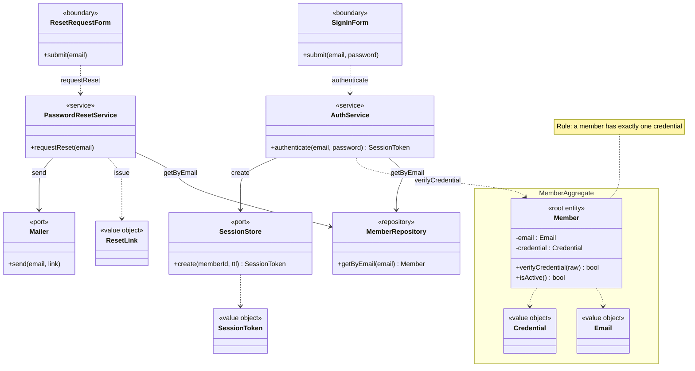
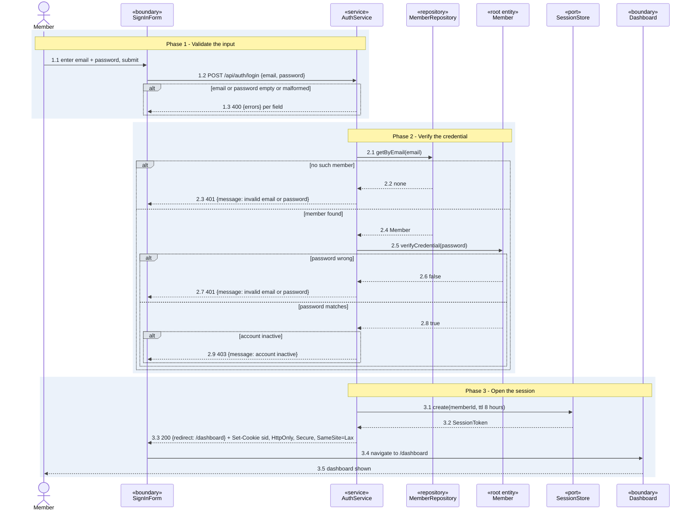
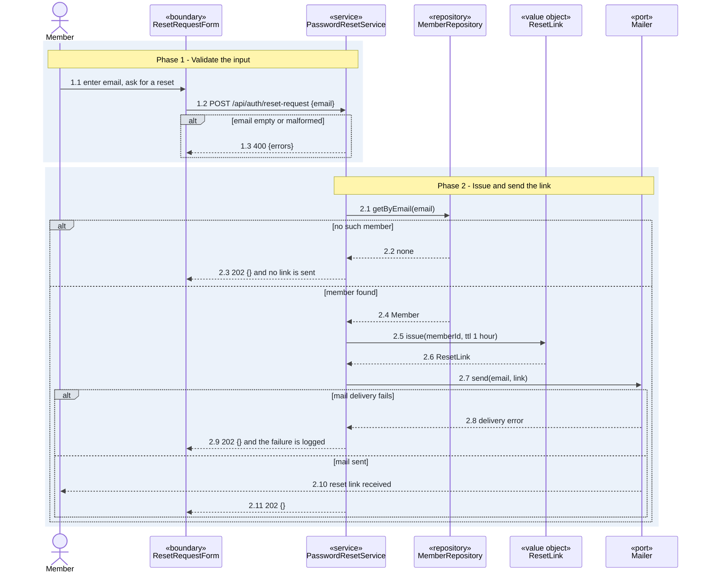

# UC-sign-in - Sign in

> **Use-case specification** with its class diagram and sequence diagrams. Drawn from the shaped
> stories below at design level; no repo was read, so every decision comes from the user or is `TBC`.

| Field | Value |
|-------|-------|
| **Slice** | sign-in |
| **Scope** | Feature: Identity and access > Sign in |
| **Primary actor** | Member |
| **Maturity** | planned |

**Stories**

<!-- stories:start -->
- IAM-0001 Sign in with email
- IAM-0002 Reset a password
<!-- stories:end -->

## Description
A member signs in with an email and password and reaches their dashboard on a cookie session, or asks
for a password reset and is sent a reset link.

## Preconditions
- The member is registered and has a password.
- The member's account is active.

## Main flow
1. The member enters an email and password on the sign-in form and submits.
2. `AuthService` looks the member up by email through `MemberRepository` and has `Member` verify the
   password.
3. `AuthService` opens a session in `SessionStore` and answers 200 with the redirect and a session cookie.
4. The member sees their dashboard.

Reset: the member asks for a reset with their email, `PasswordResetService` issues a `ResetLink` and
`Mailer` sends it, and the form always shows the same confirmation.

## Alternative and exception flows
- **Invalid input** -> 400 with the field errors, nothing is looked up.
- **Unknown email** and **wrong password** -> the same 401 message, so the sign-in does not reveal
  which emails are registered.
- **Inactive account** -> 403, only after the password matched.
- **Reset for an unknown email** -> the same 202 as a known one, and no link is sent.
- **Mail delivery fails** -> 202, the failure is logged and the member can ask again.

## Postconditions
- After sign-in, the member holds a session cookie and sees their dashboard.
- After a reset request, a reset link has been sent to a registered member, and the form shows the same
  confirmation for every email.

## Acceptance criteria

| AC id | Story | Path | Flow | Given / when / then | Steps |
|---|---|---|---|---|---|
| **AC-sign-in-dashboard** | Sign in with email | main | login | Given a registered member, when they sign in with the right password, then they see their dashboard. | 1.1, 1.2, 2.1, 2.4, 2.5, 2.8, 3.1, 3.3, 3.5 |
| **AC-sign-in-reset-link** | Reset a password | main | reset | Given a registered member, when they ask for a reset, then they are sent a reset link. | 1.1, 1.2, 2.1, 2.4, 2.5, 2.7, 2.10, 2.11 |

## Class diagram

## Sequence diagrams

### Sequence: login

### Sequence: reset

## Design decisions

| D id | Decision | Alternatives | Why | Source | Steps |
|---|---|---|---|---|---|
| D1 | A signed-in session is a server-side session behind an HttpOnly cookie | Bearer token in local storage | the page script cannot read the cookie | user-confirmed | login 3.1, 3.3 |
| D2 | A session lasts 8 hours | 30 minutes, 7 days | one working day without signing in again | user-confirmed | login 3.1 |
| D3 | An unknown email and a wrong password get the same 401 message | distinct messages | a caller cannot learn which emails are registered | user-confirmed | login 2.3, 2.7 |
| D4 | A reset request answers 202 whether or not the email is registered | 404 for an unknown email | the form does not reveal which emails are registered | user-confirmed | reset 2.3, 2.9, 2.11 |
| D5 | The `Member` aggregate owns `Email` and `Credential`, and protects "a member has exactly one credential" | `Credential` as its own aggregate | the credential is never read without its member | user-confirmed | login 2.5 |
| D6 | A reset link is valid for 1 hour | 15 minutes, 24 hours | long enough to read the mail, short enough to limit a stolen link | user-confirmed | reset 2.5 |
| D7 | Lockout after repeated wrong passwords | none, a delay | not decided | TBC | login 2.5 |

## Interface contracts

| Flow | Method and path or message | Request | Success response | Steps |
|---|---|---|---|---|
| login | `POST /api/auth/login` | `{email, password}` | `200 {redirect: "/dashboard"}` and a session cookie | 1.2, 3.3 |
| reset | `POST /api/auth/reset-request` | `{email}` | `202 {}` | 1.2, 2.11 |

## Failure responses

| Failure | Trigger | Client response | AC id | Step |
|---|---|---|---|---|
| login input invalid | email or password empty or malformed | 400 `{errors}` per field | AC-sign-in-dashboard | login 1.3 |
| login unknown email | no member has the email | 401 `invalid email or password`, the same as a wrong password on purpose (D3) | AC-sign-in-dashboard | login 2.3 |
| login wrong password | the password does not match | 401 `invalid email or password`, the same as an unknown email on purpose (D3) | AC-sign-in-dashboard | login 2.7 |
| login account inactive | the password matched and the account is inactive | 403 `account inactive` | AC-sign-in-dashboard | login 2.9 |
| reset input invalid | email empty or malformed | 400 `{errors}` | AC-sign-in-reset-link | reset 1.3 |
| reset unknown email | no member has the email | 202 `{}`, the same as success on purpose (D4), no link is sent | AC-sign-in-reset-link | reset 2.3 |
| reset mail not delivered | the mail port reports an error | 202 `{}`, the same as success on purpose (D4), the failure is logged | AC-sign-in-reset-link | reset 2.9 |

## Non-functional and security rules

| Rule | Source | Steps |
|---|---|---|
| The session cookie is HttpOnly, Secure and SameSite=Lax | user-confirmed | login 3.3 |
| The password and the reset link are never logged | user-confirmed | login 1.2, reset 2.7 |
| A password is stored only as a salted hash | TBC | login 2.5 |

## Open questions

| Item | Blocking |
|---|---|
| How many wrong passwords lock an account, and for how long (D7) | no |
| Which hash function stores the password | no |

## Implementation overview
TBC

## Traceability
TBC
