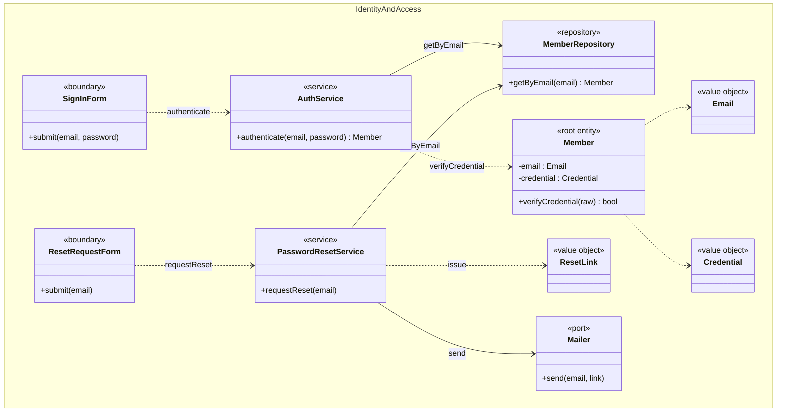
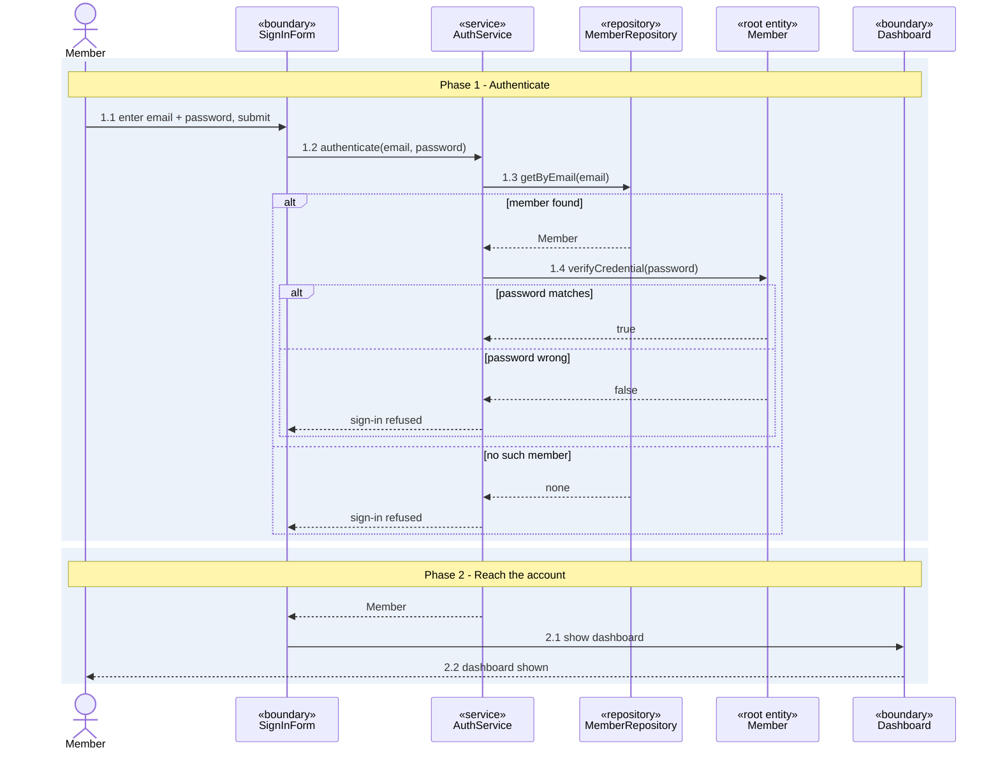
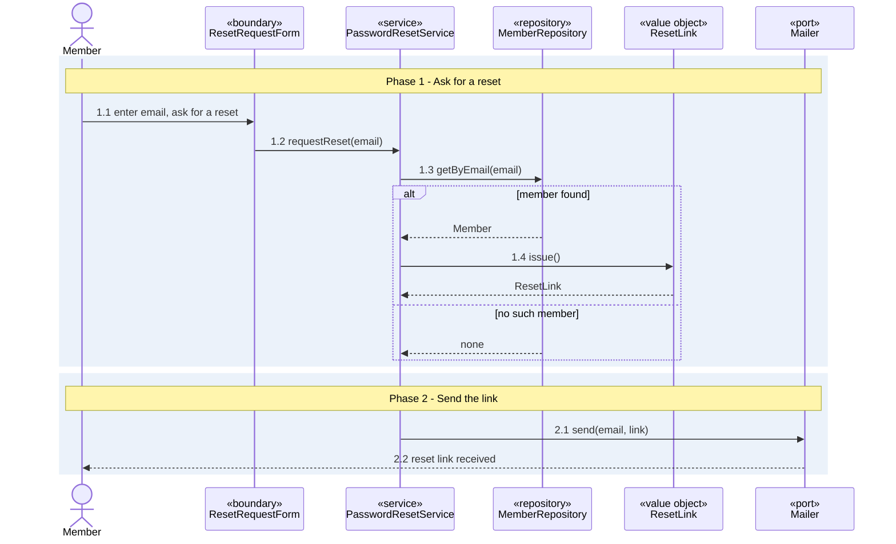

# UC-sign-in - Sign in

> **Use-case specification** with its class diagram and sequence diagrams. Drawn from the shaped
> stories below; it is analysis level (no repo was read).

| Field | Value |
|-------|-------|
| **Slice** | sign-in |
| **Scope** | Feature: Identity and access > Sign in |
| **Primary actor** | Member |
| **Maturity** | planned |

**Stories**

<!-- stories:start -->
- IAM-0001 Sign in with email
- IAM-0002 Reset a password
<!-- stories:end -->

## Description
A member signs in with an email and password and reaches their dashboard, or asks for a password reset
and is sent a reset link.

## Preconditions
- The member is registered and has a password.

## Main flow
1. The member enters an email and password on the sign-in form.
2. `AuthService` looks the member up by email through `MemberRepository` and verifies the password.
3. The member sees their dashboard.

Reset: the member asks for a reset with their email, `PasswordResetService` issues a `ResetLink` and
`Mailer` sends it.

## Alternative and exception flows
- **Unknown email or wrong password** (to be confirmed with the product owner, no story states it) ->
  the sign-in is refused and no dashboard is shown.
- **Reset for an unknown email** (to be confirmed) -> no link is sent.

## Postconditions
- After sign-in, the member is authenticated and sees their dashboard.
- After a reset request, a reset link has been sent to the member.

## Acceptance criteria

| AC id | Story | Path | Flow | Given / when / then |
|---|---|---|---|---|
| **AC-sign-in-dashboard** | Sign in with email | main | login | Given a registered member, when they sign in with the right password, then they see their dashboard. |
| **AC-sign-in-reset-link** | Reset a password | main | reset | Given a registered member, when they ask for a reset, then they are sent a reset link. |

## Implementation overview
TBC

## Traceability
TBC

## Class diagram

## Sequence diagrams

### Sequence: login

### Sequence: reset

