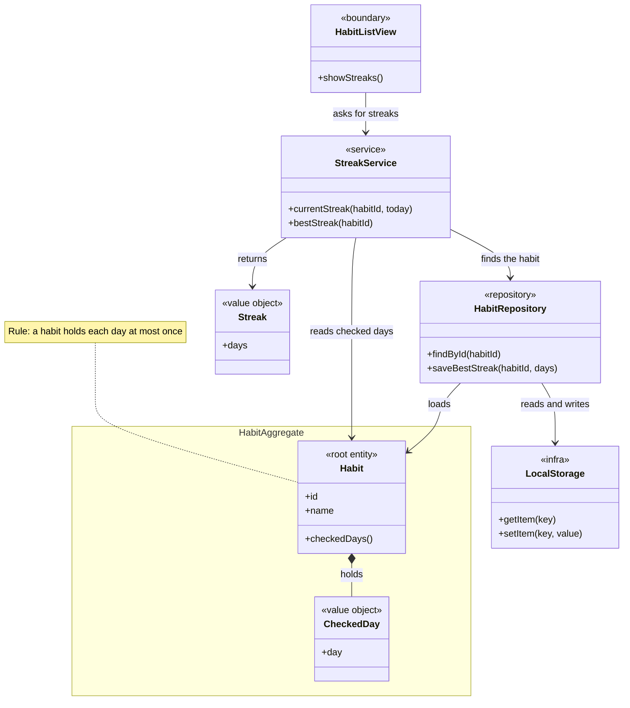
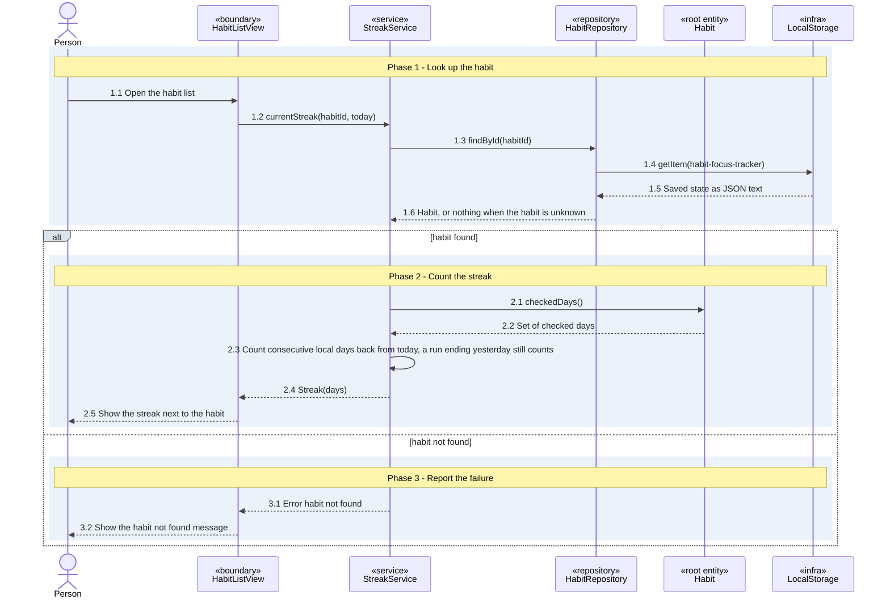
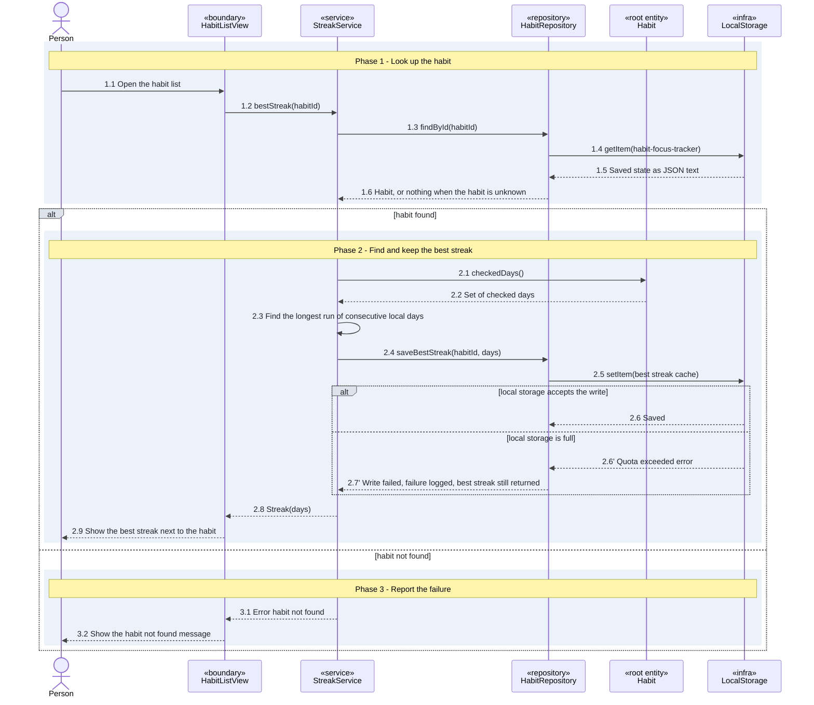

# Streaks

The habit list shows two numbers next to each habit: the current streak (consecutive days checked off) and the best streak (the longest such run the habit ever had).

## How a streak is counted

Days are the person's local calendar days, so a check-off at 23:30 counts for that evening. A run that ends yesterday still counts, so a day is not lost before the person checks in. A habit holds each day at most once: saved duplicates collapse when the state is read. Saved data is read as data: an entry in the habit list that is not a habit is skipped, a habit without a list of check-offs gets an empty one, and a check-off that is not a real YYYY-MM-DD day is ignored, so one bad entry never blanks the page or drops the other habits.

## Best streak cache

The check-offs are the single source of truth. The best streak of every habit is recomputed from them and kept in local storage (`habit-focus-tracker-best-streaks`) when the app starts and when a check-off changes, never while the list is drawn. The cache holds one entry per existing habit. A full local storage does not block the shown best streak: the write failure is logged.

## Known limits

Check-offs saved before the day moved from UTC to local time were stored under the UTC date. The app cannot tell which time zone the person was in then, so it does not convert them. For a person away from UTC this can leave a gap or a one-day shift in an old run. This is the open question "how check-offs already saved under UTC days are treated" of the streaks slice; it is not blocking and stays open until the owner decides.

## Calls between app parts

The app is a browser app, so these are calls between parts of the app, with no HTTP and no server. Counting 1000 check-offs takes under 100 ms.

| Call | Takes | Returns |
|---|---|---|
| `StreakService.currentStreak` | habit id, today (local day, YYYY-MM-DD) | Streak (days) |
| `StreakService.bestStreak` | habit id | Streak (days) |
| `HabitRepository.findById` | habit id | The habit with its checked days |
| `HabitRepository.saveBestStreak` | habit id, days | Saved, or a logged write failure |

<!-- archive:habits/streaks:start -->
## Feature "Habit tracking > Streaks"

### Behaviour

#### See the current streak

| Situation | Result | AC id |
|---|---|---|
| A habit was checked off on each of the last 3 days and I open the habit list | It shows a streak of 3 | AC-streaks-current-streak |
| The run ends yesterday and not today | The streak still counts | none |
| The check-off was made at 23:30 local time | It counts for that local day | none |
| The habit id is not in the saved state | The error "habit not found" is shown | none |
| The saved state does not parse | The state is empty and the page still draws | none |

#### See the best streak

| Situation | Result | AC id |
|---|---|---|
| A habit's longest run was 5 days, its current streak is 2, and I open the habit list | It shows a best streak of 5 | AC-streaks-best-streak |
| A habit has no checked days | The best streak is 0 | none |
| The habit id is not in the saved state | The same error "habit not found" is shown | none |
| Local storage is full when the best streak is kept | The best streak is still shown | none |
| Local storage is full when the best streak is kept | The write failure is logged | none |

### How it fits together

#### current-streak

#### best-streak

### Decisions

| Decision | Why | Who chose |
|---|---|---|
| A streak counts consecutive calendar days in the person's local time zone | A check-off at 23:30 must count for that evening | user-confirmed |
| A streak that ends yesterday still counts | The day is not lost before the person checks in, and one missed morning does not erase a run | user-confirmed |
| An unknown habit gets the same "habit not found" error for the current and the best streak | One error for one cause | user-confirmed |
| The best streak is recomputed from the check-offs and kept in local storage as a cache | The check-offs stay the single source of truth | user-confirmed |
| The Habit aggregate owns the set of checked days and protects "a habit holds each day at most once" | The root guards its own rule | user-confirmed |
| A full local storage does not block the best streak: it is shown and the failure is logged | The person still sees the best streak | user-confirmed |
<!-- archive:habits/streaks:end -->

## Sources

| Slice | Scope | Date | Review | Stories | Commit |
|---|---|---|---|---|---|
| habits/streaks | Feature "Habit tracking > Streaks" | 2026-11-12 | review: run | See the current streak (afb3d4cdba1b); See the best streak (3cbcd75e0d93) | 05c0b725dc5f69a487c7b2db702c74aa7b990814 |
