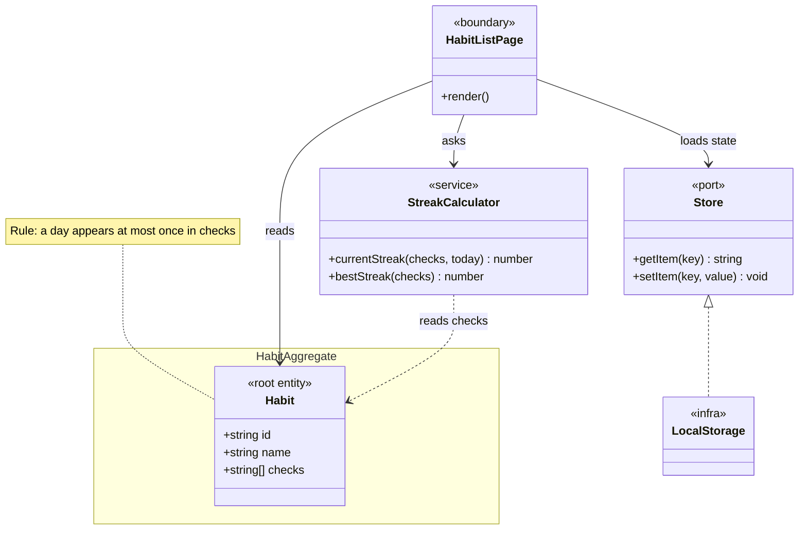
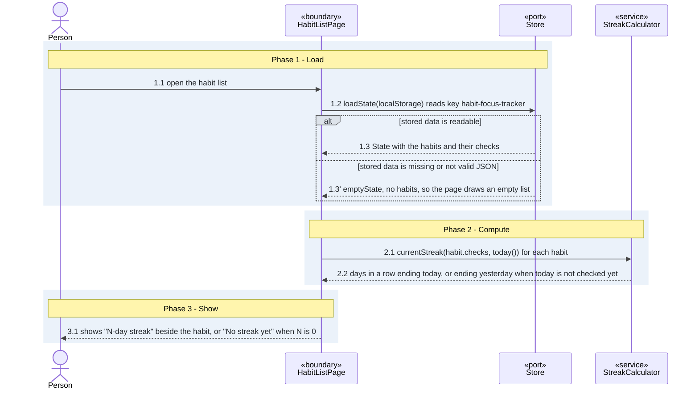
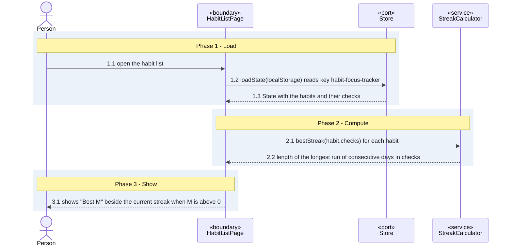

# Streaks: design

<!-- archive:habits/streaks:start -->
## Streaks (Feature Streaks, Epic Habit tracking)

### Behaviour

#### See the current streak

| Situation | Result | AC id |
|---|---|---|
| A habit was checked off on each of the last 3 days and I open the habit list | The habit shows a streak of 3 | AC-streaks-current-shown |
| A habit was checked off on the 3 days before today and today is not checked yet | The habit still shows a streak of 3 | none |
| A habit has no run of checked days | The habit shows "No streak yet" | none |
| Local storage holds no state, or text that is not valid JSON | The page draws an empty habit list and no streaks | none |
| The page works out a streak | It uses only the browser's local data and sends nothing to a server | none |

#### See the best streak

| Situation | Result | AC id |
|---|---|---|
| A habit's longest run was 5 days, its current streak is 2, and I open the habit list | The habit shows a best streak of 5 | AC-streaks-best-shown |
| I open the habit list on a narrow (mobile) window | "Best M" sits under the habit name | none |
| A screen reader reads a habit | It reads the streak and best labels with the habit, because they are text | none |

### How it fits together

#### see-current-streak

#### see-best-streak

### Decisions

| Decision | Why | Who chose |
|---|---|---|
| Streaks are worked out when the list is drawn from `Habit.checks`, and not stored | No migration of saved data, and the count cannot drift from the check-off days | user-confirmed |
| The current streak counts the days in a row that end today, or end yesterday when today is not checked yet | A habit checked 3 days running does not drop to 0 each morning before the person checks it | user-confirmed |
| A day appears at most once in `Habit.checks` (the rule `toggleCheck` already keeps) | The count of consecutive days stays correct | repo |
| The current streak shows as the pill "N-day streak", a habit with no run shows "No streak yet", and "Best M" shows beside the pill; on mobile "Best M" sits under the habit name (artboards [streaks-list-default-desktop](https://claude.ai/artifact/HjAw3uh4iutuwMEG6F8Bco#artboard-streaks-list-default-desktop), [streaks-list-best-mobile](https://claude.ai/artifact/HjAw3uh4iutuwMEG6F8Bco#artboard-streaks-list-best-mobile)) | The artboards fix the wording and the place | user-confirmed |
<!-- archive:habits/streaks:end -->

## Sources

| Slice | Scope | Date | Review | Stories | Commit |
|---|---|---|---|---|---|
| habits/streaks | Feature Streaks (Epic Habit tracking) | 2026-11-20 | review: run | See the current streak (afb3d4cdba1b); See the best streak (3cbcd75e0d93) | f93dadf3394d6ed648ef51eb9d87f2b0403082b7 |
