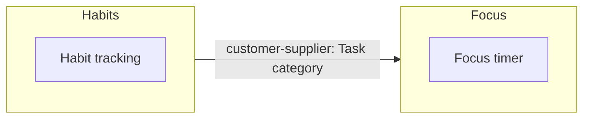

# Context map

Generated from `context-map.json`; edit the map through `jois-story-plan`, not this file.

## Contexts

| Context | Owner | Epics | Purpose |
|---|---|---|---|
| Habits | App team | Habit tracking | What a person tracks every day and how long they keep it up |
| Focus | TBC | Focus timer | How a person runs and counts focus sessions |

## Relationships

| Upstream | Downstream | Type | Crosses |
|---|---|---|---|
| Habits | Focus | customer-supplier | Task category |

## Diagram

