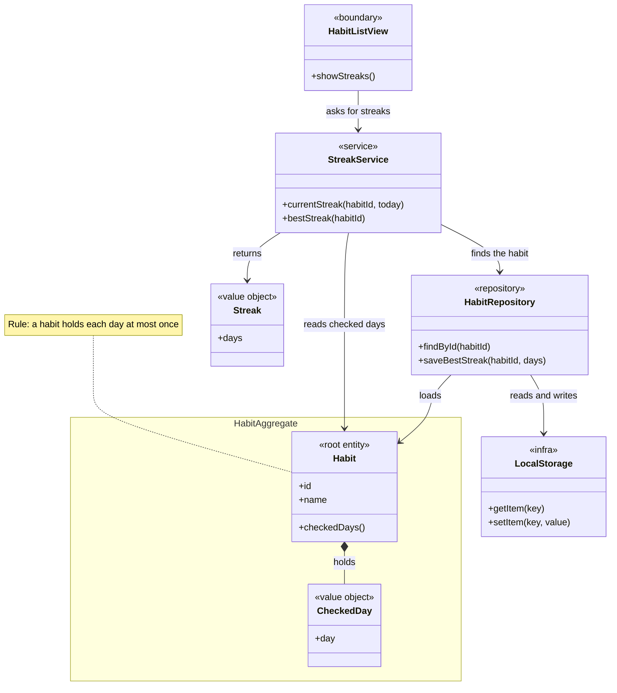
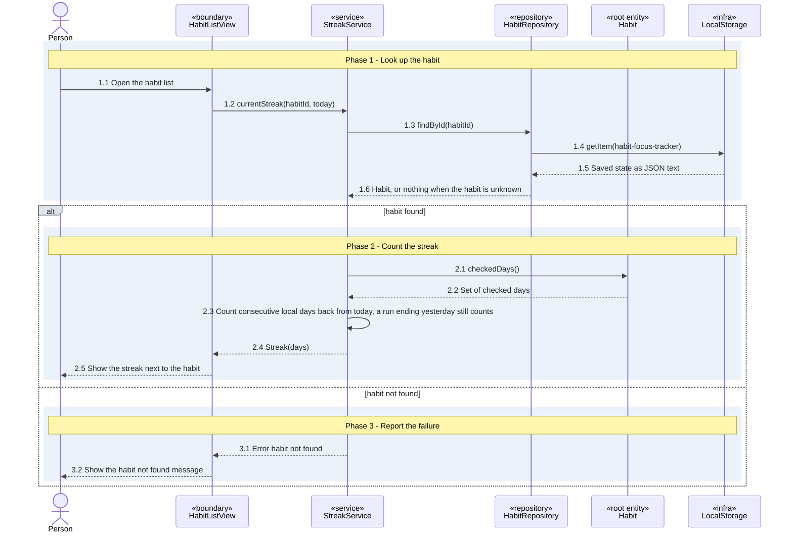
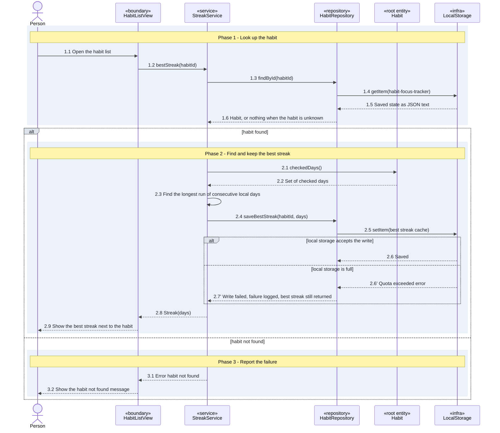

# UC-streaks - Streaks

| Field | Value |
|---|---|
| Slice | streaks |
| Scope | Feature "Habit tracking > Streaks" |
| Primary actor | Person |
| Maturity | partial: habit check-offs exist in the code, the streak code is planned |

## Stories

<!-- stories:start -->
- H1-HT-0001 See the current streak
- H1-HT-0002 See the best streak
<!-- stories:end -->

## Description

A person sees, next to each habit in the habit list, the current streak (consecutive days the habit was checked off) and the best streak (the longest such run the habit ever had). The app is a browser app that keeps its data in local storage, so every call is between parts of the app; there is no HTTP and no server. The Habits context owns this slice; the Focus context is not drawn.

## Preconditions

- The habit exists and its checked days are in local storage.

## Main flow

1. The person opens the habit list.
2. The app counts the current streak of each habit from its checked days and shows it.
3. The app finds the best streak of each habit, keeps it in local storage as a cache, and shows it.

## Alternative and exception flows

- The habit is unknown: the app answers "habit not found", for the current and the best streak alike.
- Local storage is full when the best streak is kept: the best streak is still shown and the failure is logged.

## Postconditions

- The habit list shows the current streak and the best streak of each habit.
- The best streak cache in local storage holds the value just computed, unless local storage was full.

## Acceptance criteria

| AC id | Story | Path | Flow | Given / when / then | Steps |
|---|---|---|---|---|---|
| AC-streaks-current-streak | See the current streak | main | current-streak | Given a habit checked off on each of the last 3 days, when I open the habit list, then it shows a streak of 3. | 1.1, 1.2, 1.3, 1.4, 1.5, 1.6, 2.1, 2.2, 2.3, 2.4, 2.5 |
| AC-streaks-best-streak | See the best streak | main | best-streak | Given a habit whose longest run was 5 days and whose current streak is 2, when I open the habit list, then it shows a best streak of 5. | 1.1, 1.2, 1.3, 1.4, 1.5, 1.6, 2.1, 2.2, 2.3, 2.4, 2.5, 2.6, 2.8, 2.9 |

## Class diagram

## Sequence diagrams

### Sequence: current-streak

### Sequence: best-streak

## Design decisions

| D id | Decision | Alternatives | Why | Source | Steps |
|---|---|---|---|---|---|
| D1 | A streak counts consecutive calendar days in the person's local time zone | UTC days | A check-off at 23:30 must count for that evening | user-confirmed | 2.3 |
| D2 | A streak that ends yesterday still counts | Reset the streak at midnight | The day is not lost before the person checks in, and one missed morning does not erase a run | user-confirmed | 2.3 |
| D3 | An unknown habit gets the same "habit not found" error for the current and the best streak | Different errors per streak | One error for one cause | user-confirmed | 3.1 |
| D4 | The best streak is recomputed from the check-offs and kept in local storage as a cache | Store it only when a run ends | The check-offs stay the single source of truth | user-confirmed | 2.3, 2.4, 2.5 |
| D5 | The Habit aggregate owns the set of checked days and protects "a habit holds each day at most once" | The service owns the set | The root guards its own rule | user-confirmed | 2.1, 2.2 |
| D6 | A full local storage does not block the best streak: it is shown and the failure is logged | Show an error and no best streak | The person still sees the best streak | user-confirmed | 2.6', 2.7' |

## Interface contracts

| Flow | Method and path or message | Request | Success response | Steps |
|---|---|---|---|---|
| current-streak | StreakService.currentStreak (call between app parts, no HTTP) | habitId, today (local day, YYYY-MM-DD) | Streak(days) | 1.2, 2.4 |
| current-streak | HabitRepository.findById (call between app parts) | habitId | Habit with its checked days | 1.3, 1.6 |
| best-streak | StreakService.bestStreak (call between app parts, no HTTP) | habitId | Streak(days) | 1.2, 2.8 |
| best-streak | HabitRepository.saveBestStreak (call between app parts) | habitId, days | Saved, or a logged write failure | 2.4, 2.6, 2.7' |

## Failure responses

| Failure | Trigger | Client response | AC id | Step |
|---|---|---|---|---|
| Habit not found (current streak) | The habit id is not in the saved state | Error "habit not found" shown to the person | AC-streaks-current-streak | 3.1 |
| Habit not found (best streak) | The habit id is not in the saved state | Error "habit not found" shown to the person (same as the current streak, D3) | AC-streaks-best-streak | 3.1 |
| Local storage full | setItem raises a quota error when the best streak is kept | The best streak is shown and the failure is logged (D6) | AC-streaks-best-streak | 2.7' |

## Non-functional and security rules

| Rule | Source | Steps |
|---|---|---|
| The streak shows in under 100 ms for 1000 check-offs; other performance targets are TBC | user-confirmed | 2.3 |
| Saved state is read as data: text that does not parse leaves an empty state, as loadState does today | repo | 1.5, 1.6 |

## Open questions

| Item | Blocking |
|---|---|
| Grace day for one missed day: not decided | no |
| How many days of check-offs the app keeps: not decided | no |
| Performance targets other than "under 100 ms for 1000 check-offs": TBC | no |
| The code stores today's day in UTC (the today function in storage.ts) while D1 counts local days: how check-offs already saved under UTC days are treated: TBC | no |

## Changes to existing specs

| Change | Wiki page | What changes | Reason |
|---|---|---|---|
| modified | Home.md | The habit list shows a streak next to each habit | The stories "See the current streak" and "See the best streak" |
| added | Streaks.md | How a streak is counted: local days, a run ending yesterday still counts, the best streak cache | The stories "See the current streak" and "See the best streak" |

## Implementation overview

The habit check-offs already exist: `Habit.checks` holds the checked days and `loadState` reads them from local storage. The slice adds a streak module with two pure functions (current and best streak over a list of days, in local days), a best streak cache next to the state in local storage, and a streak label in the habit list render. The day helper `today` currently uses UTC and moves to the local day (D1).

## Traceability

| Step | What | Code |
|---|---|---|
| 1.1 | The habit list renders | `app/src/main.ts::render` |
| 1.3, 1.4, 1.5 | The saved state is read and parsed | `app/src/storage.ts::loadState` |
| 1.6 | The habit is found by id | `app/src/storage.ts::Habit` (lookup by id is planned) |
| 2.1, 2.2 | The checked days of the habit | `app/src/storage.ts::Habit` |
| 2.3 | Count the current streak and the best streak | `app/src/streak.ts::currentStreak` (planned) |
| 2.4, 2.5 | Keep the best streak cache | `app/src/storage.ts::saveState` |
| 2.5 | Show the streaks next to the habit | `app/src/main.ts::render` |
