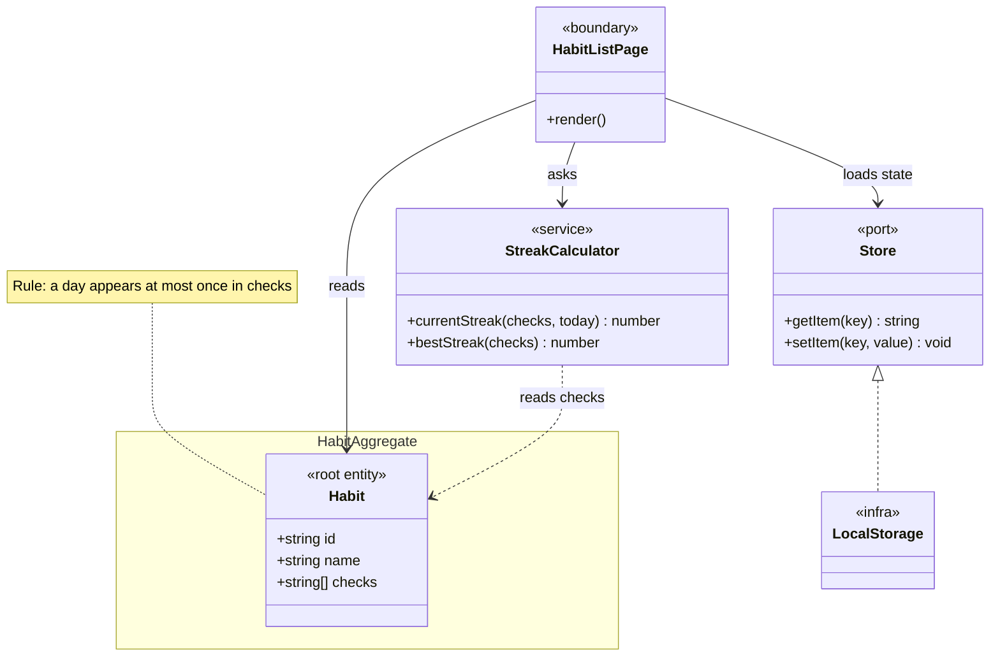
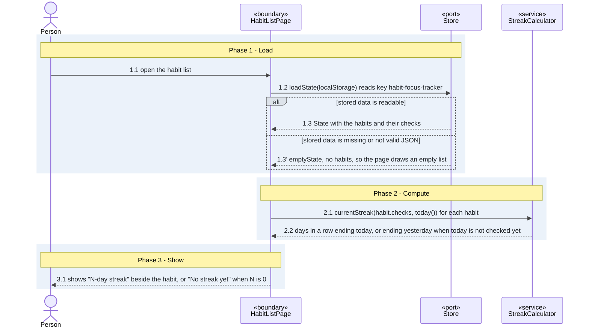
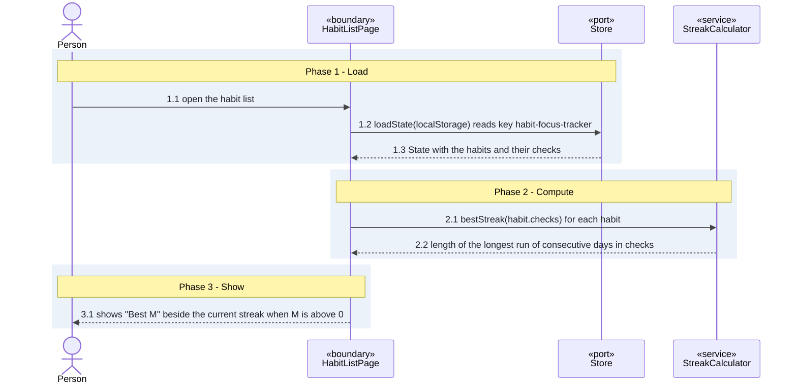

# UC-streaks - Streaks

| Row | Value |
|---|---|
| Slice | streaks |
| Scope | Feature Streaks (Epic Habit tracking) |
| Primary actor | Person building habits |
| Maturity | implemented base, extended by this slice |

## Stories

<!-- stories:start -->
- H1-HT-0001 See the current streak
- H1-HT-0002 See the best streak
<!-- stories:end -->

## Description

A person who checks off habits on the habit list sees, beside each habit, how many days in a row it was checked off (the current streak) and the longest run it ever had (the best streak). Both numbers are worked out from the days already stored in `Habit.checks`, when the list is drawn. Nothing new is stored.

## Preconditions

- The habit list is open in the browser and the habit exists.
- The habit's check-off days are in browser local storage under the key `habit-focus-tracker`.

## Main flow

1. The person opens the habit list.
2. The page loads the saved state.
3. For each habit the page works out the current streak and the best streak from its check-off days.
4. The page shows "N-day streak" and "Best M" beside the habit, or "No streak yet" when the habit has no run.

## Alternative and exception flows

- Stored data cannot be read: the page starts from an empty state and shows no habits (step 1.3').

## Postconditions

- The habit list shows the streaks. No stored data changed.

## Acceptance criteria

| AC id | Story | Path | Flow | Given / when / then | Steps |
|---|---|---|---|---|---|
| AC-streaks-current-shown | See the current streak | main | see-current-streak | Given a habit checked off on each of the last 3 days, when I open the habit list, then it shows a streak of 3. | 1.3, 2.1, 2.2, 3.1 |
| AC-streaks-best-shown | See the best streak | main | see-best-streak | Given a habit whose longest run was 5 days and whose current streak is 2, when I open the habit list, then it shows a best streak of 5. | 1.3, 2.1, 2.2, 3.1 |

## Class diagram

## Sequence diagrams

### Sequence: see-current-streak

### Sequence: see-best-streak

## Design decisions

| D id | Decision | Alternatives | Why | Source | Steps |
|---|---|---|---|---|---|
| D-streaks-derived | Streaks are worked out when the list is drawn from `Habit.checks`, and not stored | Store a streak count on each habit | No migration of saved data, and the count cannot drift from the check-off days | user-confirmed | 2.1, 2.2 |
| D-streaks-today | The current streak counts the days in a row that end today, or end yesterday when today is not checked yet | Count only runs that end today | A habit checked 3 days running does not drop to 0 each morning before the person checks it | user-confirmed | 2.2 |
| D-streaks-aggregate | A day appears at most once in `Habit.checks` (the rule `toggleCheck` already keeps) | Allow duplicates | The count of consecutive days stays correct | repo | 1.3 |
| D-streaks-badge | The current streak shows as the pill "N-day streak", a habit with no run shows "No streak yet", and "Best M" shows beside the pill; on mobile "Best M" sits under the habit name (artboards [streaks-list-default-desktop](https://claude.ai/artifact/HjAw3uh4iutuwMEG6F8Bco#artboard-streaks-list-default-desktop), [streaks-list-best-mobile](https://claude.ai/artifact/HjAw3uh4iutuwMEG6F8Bco#artboard-streaks-list-best-mobile)) | Show the numbers in a separate section | The artboards fix the wording and the place | user-confirmed | 3.1 |

## Interface contracts

| Flow | Method and path or message | Request | Success response | Steps |
|---|---|---|---|---|
| see-current-streak | `currentStreak(checks, today)` called by `render` | `checks`: days as YYYY-MM-DD, `today`: YYYY-MM-DD | whole number of days, 0 when there is no run | 2.1, 2.2 |
| see-best-streak | `bestStreak(checks)` called by `render` | `checks`: days as YYYY-MM-DD | whole number of days, 0 when there are no checks | 2.1, 2.2 |

## Failure responses

| Failure | Trigger | Client response | AC id | Step |
|---|---|---|---|---|
| Stored data unreadable | Local storage holds no state, or text that is not valid JSON | The page draws an empty habit list and no streaks | AC-streaks-current-shown | 1.3' |

## Non-functional and security rules

| Rule | Source | Steps |
|---|---|---|
| Streaks are worked out in the browser from local data and nothing is sent to a server | repo | 2.1 |
| The streak and best labels are text, so a screen reader reads them with the habit | user-confirmed | 3.1 |

## Open questions

| Item | Blocking |
|---|---|
| None | no |

## Changes to existing specs

None

## Implementation overview

The two functions `currentStreak` and `bestStreak` are added next to the `Habit` type in `app/src/storage.ts` and tested in `app/src/storage.test.ts`. `render` in `app/src/main.ts` calls them for each habit and writes the pill and the "Best M" text beside the checkbox label. No stored field and no new file is added.

## Traceability

| Step | What | Code |
|---|---|---|
| 1.1 | The page is drawn when the app loads | `app/src/main.ts::render` |
| 1.2 | The state is read from local storage | `app/src/storage.ts::loadState` |
| 1.3 | The habits and their check-off days are returned | `app/src/storage.ts::Habit` |
| 1.3' | Unreadable data gives an empty state | `app/src/storage.ts::emptyState` |
| 2.1 | The streak functions are called for each habit and read `Habit.checks` | `app/src/storage.ts::Habit` |
| 2.2 | The day that ends the run comes from `today` | `app/src/storage.ts::today` |
| 3.1 | The list item markup is drawn | `app/src/main.ts::render` |
