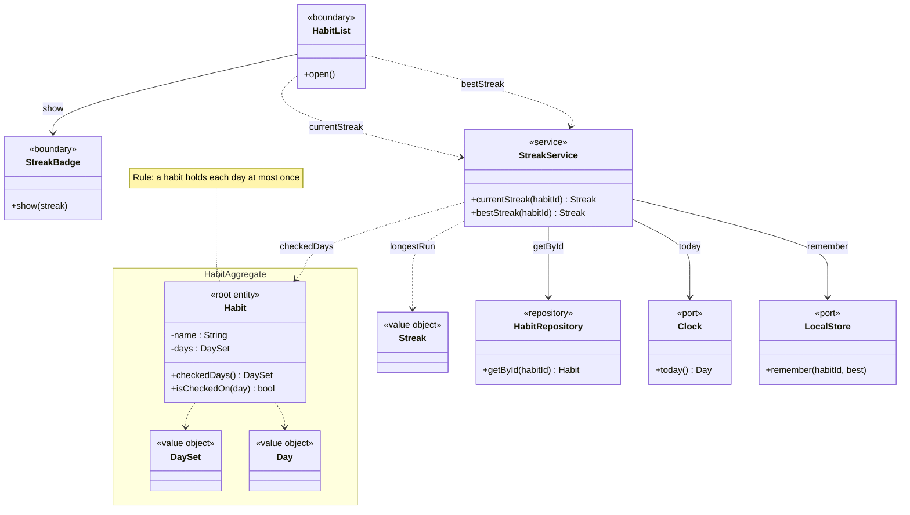
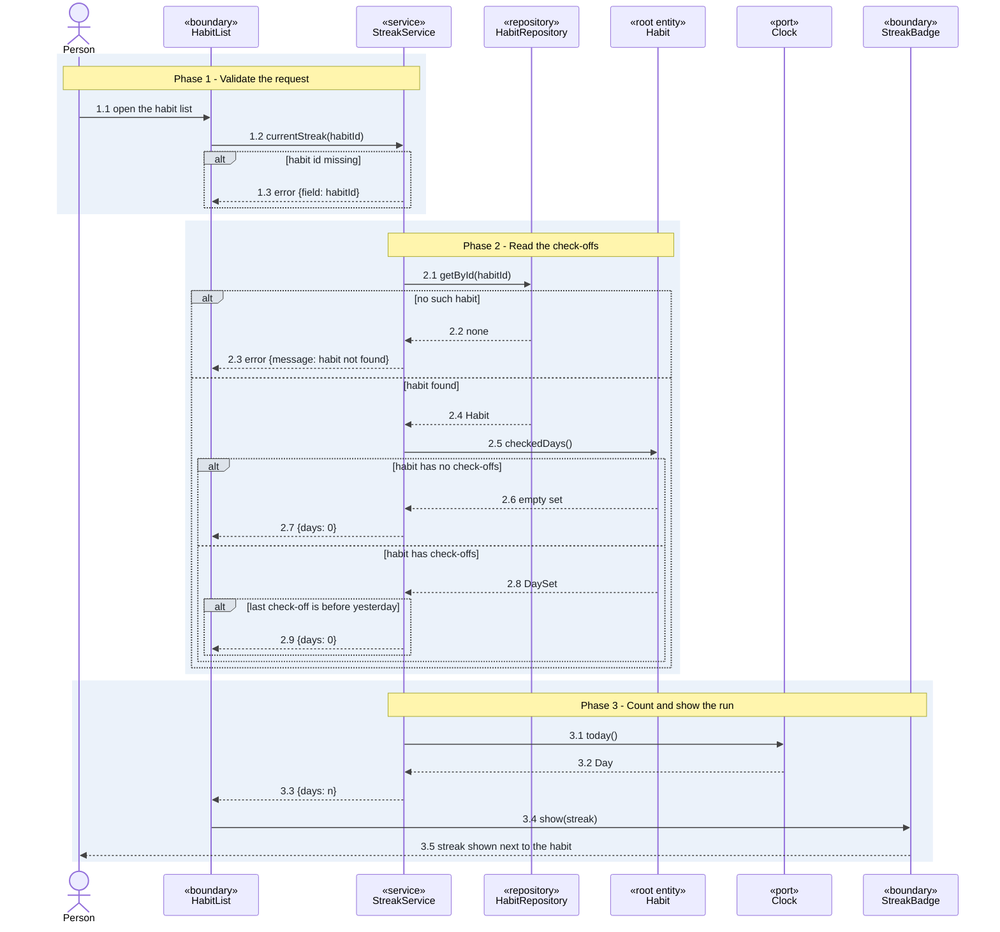
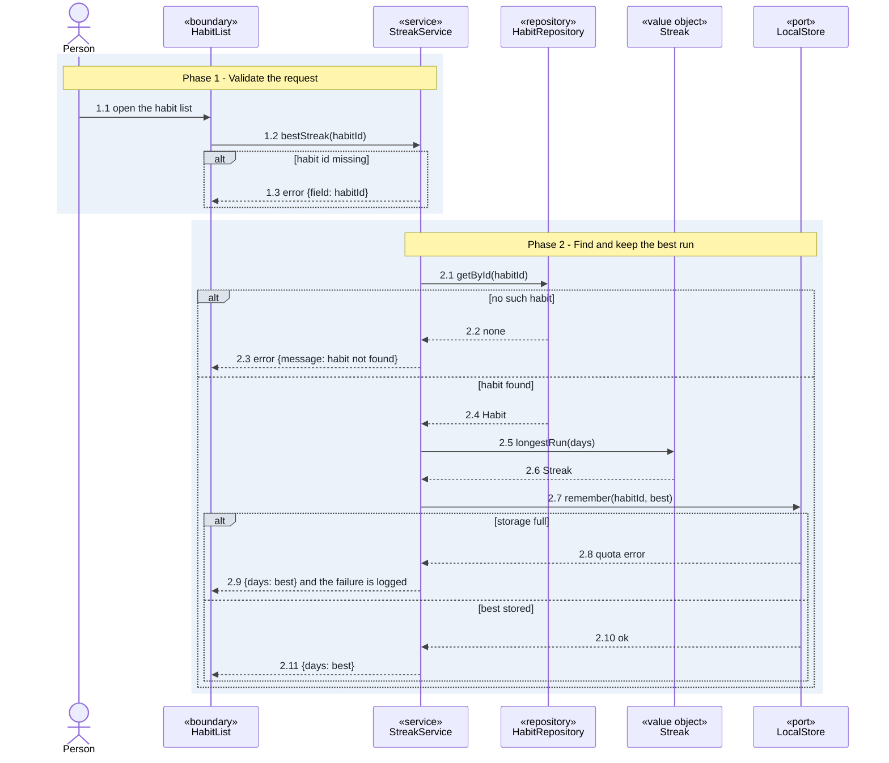

# UC-streaks - Streaks

> **Use-case specification** with its class diagram and sequence diagrams. Drawn from the shaped
> stories below at design level; the code base was read only for the wiki, so every decision comes from the user or is `TBC`.

| Field | Value |
|-------|-------|
| **Slice** | streaks |
| **Scope** | Feature: Habit tracking > Streaks |
| **Primary actor** | Person |
| **Maturity** | planned |

**Stories**

<!-- stories:start -->
- H1-HT-0001 See the current streak
- H1-HT-0002 See the best streak
<!-- stories:end -->

## Description
A person opens the habit list and sees, next to each habit, how many days in a row it was checked off up
to today, and the longest run it has ever had.

## Preconditions
- The habit exists in the browser's local storage.
- The browser allows local storage.

## Main flow
1. The person opens the habit list.
2. `StreakService` loads the habit through `HabitRepository` and has `Habit` list the days it was
   checked off.
3. `StreakService` asks `Clock` for today, counts the run of consecutive days that ends today or
   yesterday, and answers with the streak.
4. The person sees the current streak next to the habit.

Best streak: the person opens the habit list, `StreakService` finds the longest run of consecutive days
with `Streak`, keeps it in `LocalStore` and answers with it.

## Alternative and exception flows
- **Missing habit id** -> an error naming the field, nothing is loaded.
- **Unknown habit** -> the same "habit not found" error for a current and a best streak.
- **No check-offs** -> a streak of 0.
- **Last check-off before yesterday** -> a streak of 0, only after the check-offs were read.
- **Storage full** -> the best streak is still shown, the failure is logged and the next open tries again.

## Postconditions
- After the current streak is shown, the person sees a number of days that matches the habit's check-offs.
- After the best streak is shown, the best streak is held in local storage unless the storage was full.

## Acceptance criteria

| AC id | Story | Path | Flow | Given / when / then | Steps |
|---|---|---|---|---|---|
| **AC-streaks-current** | See the current streak | main | current | Given a habit checked off on each of the last 3 days, when I open the habit list, then it shows a streak of 3. | 1.1, 1.2, 2.1, 2.4, 2.5, 2.8, 3.1, 3.3, 3.5 |
| **AC-streaks-best** | See the best streak | main | best | Given a habit whose longest run was 5 days and whose current streak is 2, when I open the habit list, then it shows a best streak of 5. | 1.1, 1.2, 2.1, 2.4, 2.5, 2.7, 2.10, 2.11 |

## Class diagram

## Sequence diagrams

### Sequence: current

### Sequence: best

## Design decisions

| D id | Decision | Alternatives | Why | Source | Steps |
|---|---|---|---|---|---|
| D1 | A streak counts consecutive calendar days in the person's local time zone | UTC days | a check-off at 23:30 must count for that evening | user-confirmed | current 3.1 |
| D2 | A streak that ends yesterday still counts, so the day is not lost before the person checks in | a streak resets at midnight | one missed morning does not erase a run | user-confirmed | current 2.9 |
| D3 | An unknown habit gets the same error for a current and a best streak | distinct messages | one message to test and to show | user-confirmed | current 2.3, best 2.3 |
| D4 | The best streak is recomputed from the check-offs and kept in local storage as a cache | store it only when a run ends | the check-offs stay the single source of truth | user-confirmed | best 2.5, 2.7 |
| D5 | The `Habit` aggregate owns `DaySet` and `Day`, and protects "a habit holds each day at most once" | `DaySet` as its own aggregate | the days are never read without their habit | user-confirmed | current 2.5 |
| D6 | A full storage does not block the best streak, it is shown and the failure is logged | show an error to the person | the number is still correct | user-confirmed | best 2.9 |
| D7 | A grace day for one missed day | none | not decided | TBC | current 2.9 |

## Interface contracts

| Flow | Method and path or message | Request | Success response | Steps |
|---|---|---|---|---|
| current | `StreakService.currentStreak` | `{habitId}` | `{days}` | 1.2, 3.3 |
| best | `StreakService.bestStreak` | `{habitId}` | `{days}` | 1.2, 2.11 |

## Failure responses

| Failure | Trigger | Client response | AC id | Step |
|---|---|---|---|---|
| current habit id missing | the habit id is empty | error `{field: habitId}` | AC-streaks-current | current 1.3 |
| current unknown habit | no habit has the id | error `habit not found`, the same as for a best streak on purpose (D3) | AC-streaks-current | current 2.3 |
| current no check-offs | the habit has no check-off | `{days: 0}` | AC-streaks-current | current 2.7 |
| current run is old | the last check-off is before yesterday | `{days: 0}` (D2) | AC-streaks-current | current 2.9 |
| best habit id missing | the habit id is empty | error `{field: habitId}` | AC-streaks-best | best 1.3 |
| best unknown habit | no habit has the id | error `habit not found`, the same as for a current streak on purpose (D3) | AC-streaks-best | best 2.3 |
| best storage full | local storage reports a quota error | `{days: best}`, the same as success on purpose (D6), the failure is logged | AC-streaks-best | best 2.9 |

## Non-functional and security rules

| Rule | Source | Steps |
|---|---|---|
| A streak is computed from check-offs in the browser and never sent anywhere | user-confirmed | current 3.3 |
| The streak shows in under 100 ms for 1000 check-offs | TBC | current 2.8 |

## Open questions

| Item | Blocking |
|---|---|
| Whether one missed day keeps a streak alive (D7) | no |
| How many days of check-offs the app keeps | no |

## Changes to existing specs

| Change | Wiki page | What changes | Reason |
|---|---|---|---|
| modified | Home.md | the habit list shows a streak next to each habit | See the current streak adds it |
| added | Streaks.md | a page describing how a streak is counted | no page describes it yet |

## Implementation overview
TBC

## Traceability
TBC
